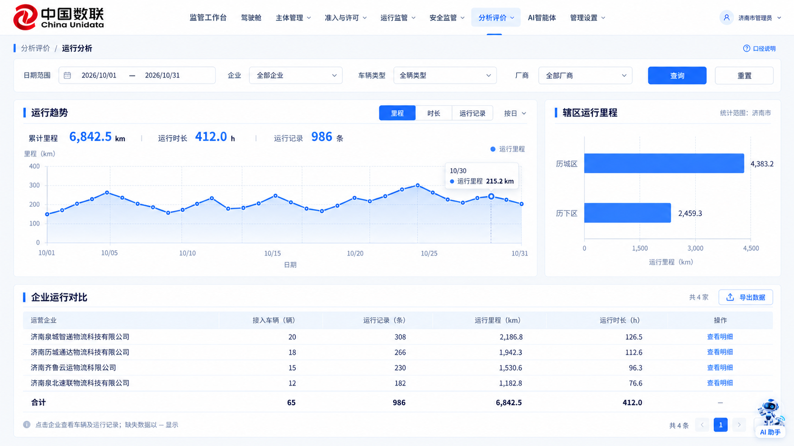
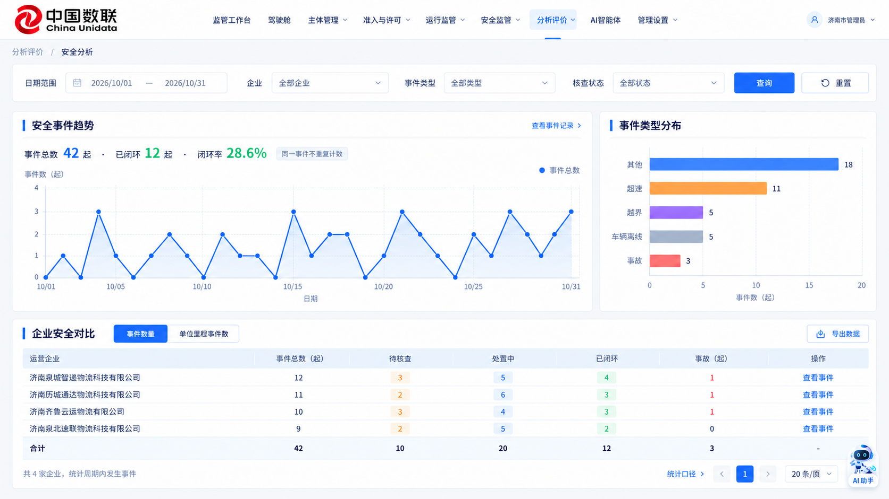
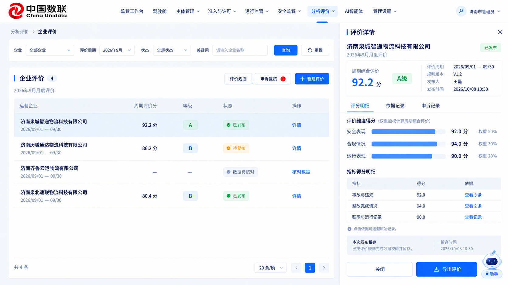
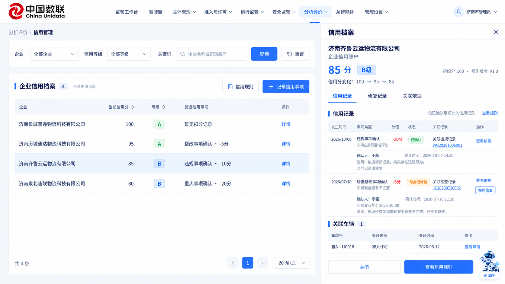
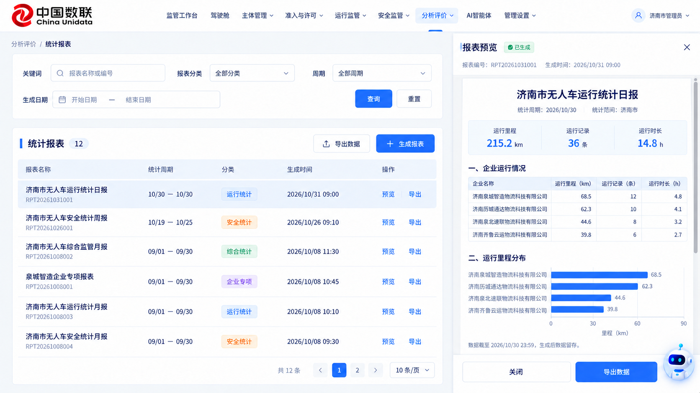

# 市级监测端 · 分析评价模块设计

日期：2026-10-31。范围：市级监管账号，以济南市为页面示例。

本文件记录功能分析、页面设计和五张图片。后续开发已完成，功能及验证结果见[开发验收说明](../../city-analysis-evaluation-acceptance-2026-10-31.md)。图中的企业分布、里程、评分等数值用于展示布局与计算关系，不代表实时查询结果；已开发页面使用当前账号有权访问的监管数据。页面不另加“演示数据”标记。

## 一、最终菜单建议

保留“分析评价”下的五个菜单，不增加同层级入口：

| 菜单 | 核心问题 | 主要功能 |
| --- | --- | --- |
| 运行分析 | 哪些企业、车辆和区域在运行，运行规模如何变化？ | 时间/企业/类型/厂商筛选，里程、时长与运行记录趋势，辖区分布，企业对比，车辆与记录明细，数据导出 |
| 安全分析 | 风险集中在哪里，事件是否得到处置？ | 统一事件趋势、类型分布、闭环情况、企业对比、单位里程事件数、穿透原事件 |
| 企业评价 | 某企业在一个周期内表现如何，得分依据是什么？ | 评价批次、规则、数据核对、发布复核、指标依据、结果发布、企业申诉复核、评价导出 |
| 信用管理 | 已确认事项对企业信用有什么影响，能否修复？ | 企业信用档案、信用事项确认、分值变动、关联依据、修复办理与历史记录 |
| 统计报表 | 如何形成可回看、可导出的周期成果？ | 日/周/月/季度及自定义周期，运行/安全/综合/企业专项分类，生成、预览、导出、历史留存 |

运行分析和安全分析共享时间、企业等筛选口径，但保留独立入口；一个面向运行规模，一个面向风险与处置。企业评价是周期结果，信用管理是持续台账，两者不合成一个分数。

### 合并、移出和补充

- **合并重复内容**：市级“企业评价”不再嵌套“本企业信用”页面。企业安全画像并入企业评价的详情与依据记录，作为查看企业表现的一个视角，不独立增加菜单。
- **内收辅助入口**：评价规则、评价批次、申诉复核放在企业评价页的工具栏、抽屉内，不增加三个平行二级菜单。
- **处置归原模块**：告警核查、事故处理、90秒事前/60秒事后证据查看、整改、检查仍由安全监管负责。安全分析只做统计和穿透，不再开发第二套处置流程。
- **补齐必要能力**：统一事件去重、数据缺失说明、指标分子分母、评价发布前核验、依据追溯、规则版本留存、信用修复入口、报表生成时的数据留存。
- **不纳入本次设计**：订单、运单、签收、履约、货量、收入与客户评分；单独的车辆信用评分；无依据的风险预测和自动处罚；登记分发；没有可靠源记录的自主运行占比。

## 二、页面设计图

### 01 · 运行分析

查询区置顶。中部以运行趋势为主、辖区里程分布为辅；里程、时长、运行记录使用切换指标方式，避免不同单位共用一个纵轴。下方企业对比显示接入车辆、运行记录、里程和时长。

点击“查看明细”打开右侧抽屉，按企业查看车辆和运行记录；继续点击记录查看起止时间、里程、时长与可用轨迹。当前车辆类型和厂商来自车辆档案，运行指标来自对应时间内的运行记录。历史记录所属区域保持历史归属，不因运营区域后来调整而重新写入。

### 02 · 安全分析

主图为按日事件数量，保留日期、单位和整数刻度。右侧分类互斥合计，下方企业对比显示事件总数、待核查、处置中、已闭环及事故数量。

“事件数量/单位里程事件数”属于同一对比维度切换。单位里程事件数 = 同周期、同企业、同车辆范围的有效事件数 ÷ 有效运行里程 × 1000，单位“起/千公里”。必须注明当前核查状态筛选；未核查事项不能被解释为已认定违规。里程缺失或为0时显示“—”，不计算排名。

闭环率的分母是选定期间发生且纳入当前筛选的去重事件，分子为其中截至查询时已闭环的事件。同一告警升级/转办为违规或事故后只计一次。车辆离线事件纳入统一来源，驳回/无效记录可追溯但不计入有效风险统计。状态映射复用安全事件工作区口径。

点击趋势日期、分类条形或企业“查看事件”，携带已应用条件打开事件列表或右侧明细；完整证据查看复用已建安全监管页面。

### 03 · 企业评价

上方查询企业、周期、状态与关键词，下方全高结果表。规则、申诉复核和新建评价位于列表工具栏；批次选择放在当前周期上下文内。点详情打开右侧抽屉，包含评分明细、依据记录和申诉记录。

建议流程：配置规则并生效 → 新建评价批次 → 检查数据范围与完整性 → 计算草稿 → 人工复核 → 发布 → 企业查看/申诉 → 复核并形成后续结果。

- “数据待核对”不生成最终综合分和等级，不得直接发布。
- 已发布结果保留本次指标值、评分依据、权重、适用规则版本、统计周期、发布人和时间。
- 修改规则用于后续计算，不能静默改写已发布结果；申诉通过后留存原结果和复核记录。
- 无数据不等同于0分，也不默认给出正常、优秀或60分。缺失指标如何补齐、排除或重新分配权重，必须由适用规则明确，不能由界面自行决定。
- 事故/违规指标使用已确认事实；联网稳定性使用有效日统计及其覆盖范围；整改指标使用已到期任务和真实复核结果。
- 不使用订单履约类指标；“运行速度越高评价越好”也不作为默认规则。

图中50%/30%/20%的权重、分值及等级是方案中的排版例子，需由业务确认后配置，不宣称为法定评价标准。周期评价分与信用分分别标注，禁止混用。

### 04 · 信用管理

主列表以企业为对象，不另建车辆信用排行榜。信用事项关联车辆、检查、违规或事故作为事实依据。列表展示当前分、等级和最近事项；右侧档案展示信用记录、修复记录、关联依据。

“记录信用事项”打开表单，先选真实来源，再确认事实、适用规则和分值影响，保存前展示确认摘要。仅有经人工确认、符合规则的事项才能记入信用；原始告警不是自动扣分依据。重复来源要提示并阻止重复扣分。

“办理修复”先校验原事项、适用修复条件和日期，再记录核查结论、材料及办理人。修复属于新的台账事件，保留原扣分事实，不删除旧记录。未满足条件时说明缺少的条件，不能仅提供一个无解释的禁用按钮。

当前项目的分值和等级为平台配置，不应在页面写成公共社会信用认定。评价分与信用分不自动互相覆盖；不能单凭分值自动撤销通行许可。

### 05 · 统计报表

上方查询名称/编号、分类、周期及生成日期；下方全高列表；右侧预览正文。生成报表时选择统计周期、分类和可选企业，明确统计范围，不提供市级账号无权访问的其他地市。

报表记录保存生成时的数据，预览和导出读取同一份已生成内容。历史报表不随当前实时数据变化；重新生成形成新的记录，保留原版本。生成失败可重试，不能展示为已完成。空统计区段要区分“暂无记录”和“未接入/缺失”。

现有服务可生成报表并导出CSV；设计中的“导出数据”沿用数据导出语义。PDF/Word、对外分发及签章不在本次范围，不应仅画下载按钮却没有可用内容。

## 三、公共交互与口径

- 保留当前红色中国数联标识、居中文字导航、蓝白视觉和通用AI助手，不新增左侧菜单。AI助手打开通用右侧对话框，无需选择智能体；为入口预留空间，不遮挡表格或抽屉按钮。
- 列表页为上方独立查询卡、下方全高列表卡；内容多时表格内部滚动，分页固定在列表底部。详情只在右侧抽屉，关闭后保留筛选、页码和滚动位置。
- 筛选编辑后点击“查询”统一应用，“重置”恢复默认值并刷新。切换企业后，清空不属于该企业的车辆条件。查询与导出使用相同已应用条件。
- 桌面在1920与1440宽度布局；窄屏筛选换行，表格允许水平滚动，抽屉转为全宽。键盘可进入筛选和详情，抽屉有关闭和焦点返回。
- 日期统一北京时间，自然日范围从00:00到23:59:59.999；跨月趋势补全整个区间，不能截断到31个日期。
- 仅有明确有效上报且数值为0的日期才能画0；缺失日期以断点/“—”表示，不能用平滑曲线补出不存在的观测值。
- 比例显示分子、分母或口径入口。分母无效时显示“—”，不将无事件的闭环率写为100%。当期尚未结束时标明统计截至时间。
- 加载态、无结果、加载失败分别呈现；失败提供重试，不能用“0”伪装接口失败。图表容器尺寸变化后重新适配，不出现只有点没有线、没有坐标或空白绘图区的问题。
- 时间、企业和车辆的范围在服务端校验；无权操作不显示对应按钮。导出、发布评价、信用确认和修复均记录操作者与审计。

## 四、现有功能核对与开发边界

本次依据本地导航、页面、服务和已有设计进行分析，没有把页面显示与业务能力视为同一件事。未开展独立用户访谈；对新流程易用性的判断仍是设计建议，待实际使用验证。

| 本地证据 | 发现 | 设计处理 | 能力状态 |
| --- | --- | --- | --- |
| auth/navigation.ts | 已有五个二级菜单 | 保留菜单，优化内容分工 | 已有 |
| OperationsAnalysisView.vue、AnalyticsService.operationAnalysis | 已有运行趋势、企业与区域汇总；里程与次数曾共用一轴 | 改为指标切换，清晰单位，明细抽屉 | 基础已有，筛选维度和明细需扩展 |
| AnalyticsService.dates、rangeDays | 旧分析按UTC边界处理，日期补全默认最多31天 | 改为北京时间完整周期，报表同口径 | 口径修正 |
| AnalyticsService.safetyAnalysis | 旧分析直接叠加告警/事故/违规，未完整复用新事件工作区 | 去重、纳入离线、统一状态与闭环分母 | 聚合改造 |
| EnterpriseEvaluationHubView.vue | 同时嵌套“本企业安全画像/本企业信用” | 市级收敛为评价结果和证据详情；信用独立 | 去重与重组 |
| AnalyticsService.scoreEnterprise | 无联网记录默认0、无应急评价默认60分等逻辑可能把缺失变成分数 | 数据核对、禁止缺失项默认评分、发布前核验 | 拟新增门禁与口径修正 |
| 评价规则/任务/结果/申诉服务 | 已有配置、计算、发布、申诉、复核和评分明细 | 在一页组织生命周期与入口 | 基础已有 |
| 现有评价结果字段 | 不能仅靠现有显示证明已留存规则版本和原始依据 | 规则生效版本、证据引用与发布留存 | 拟新增持久化与流程 |
| GovernanceService.creditAccounts/addCreditEntry/repairCredit | 已有账户、人工扣分和修复；当前信用页修复及完整详情不足 | 企业档案、来源校验、修复入口、全量历史 | 基础已有，界面与约束需补齐 |
| RegulatoryReportsView.vue、报告服务 | 已有分类、周期、生成、summary留存与CSV导出 | 列表+右侧预览、明确生成与统计日期 | 基础已有，页面重组 |

涉及新规则版本、源证据快照、发布复核、信用修复材料与防重复确认的内容属于后续开发项，本次图片不代表这些能力已经上线。

### 验证清单（供后续开发验收）

1. 查询、图表、表格、详情和导出使用相同城市及时间范围；跨城市访问被拒绝。
2. 跨月、跨日边界按北京时间统计；缺失与真0区分；各图均有坐标与单位。
3. 同一事件从告警转为事故/违规不重复；状态数量之和与事件总数一致。
4. 单位里程比较使用匹配范围和有效分母，不能把无数据企业放到“零风险”榜首。
5. 无数据或未复核的评价不能发布；后改规则不改变已发布记录；申诉链路可回看。
6. 信用来源可追溯，重复确认不重复扣分；修复保留原扣分和办理记录。
7. 生成后报表的预览与导出一致，不读当前变动数据；分页与记录总数一致。
8. 详情抽屉、通用AI助手、1440与1920布局、键盘操作和失败重试可用。

## 五、生成方式与文件

图片使用内置 image_gen 工具生成，模式为ui-mockup，参考项目当前工作台的导航及已有监管模块视觉；没有使用CLI/API回退方式。最终文件已复制到本目录，原生成文件保留。

- 01-operations-analysis.png
- 02-safety-analysis.png（事件整数趋势修订版）
- 03-enterprise-evaluation.png（通用AI入口补齐版）
- 04-credit-management.png
- 05-statistical-reports.png（标题、分页与AI入口校订版）

完整提示词和参考路径见[提示词集](./prompts.json)，修订提示词见[safety-chart-revision.json](./safety-chart-revision.json)、[reports-proofreading.json](./reports-proofreading.json)及[evaluation-assistant-revision.json](./evaluation-assistant-revision.json)。最终图片与原始生成文件对应关系见[outputs.json](./outputs.json)。本目录为设计交付，尚未进行应用功能开发或浏览器验收。

